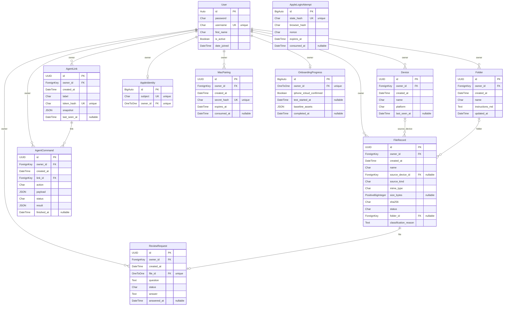

# 모아 ERD

Django 모델 기준 · 2026-11-06 · 슬라이드는 주요 필드만 표시하고 아래는 전체 업무 필드를 표시합니다.

[발표자료](index.html#slide-11) · [파일 ERD SVG](assets/erd-library.svg) · [연결 ERD SVG](assets/erd-agent.svg)

클라우드 DB는 사용자별 메타데이터·스냅샷·명령을 저장합니다. 파일 본문, 로컬 작업 상태와 `_project.md`는 Mac에 남습니다. 기본 DB는 SQLite이며 Django 세션·권한용 내부 테이블은 아래 업무 ERD에서 생략합니다.

- `OwnedModel`은 추상 모델이며 별도 테이블이 없습니다. 상속 엔티티마다 UUID `id`, `owner_id`, `created_at`이 들어갑니다.
- `Folder`는 `(owner_id, name)` 복합 고유 제약을 가집니다.
- `FileRecord.source_device`와 `FileRecord.folder`는 선택 관계입니다. 참조 기기·폴더를 삭제하면 `SET_NULL`로 파일 기록을 유지합니다.
- `ReviewRequest.file`은 고유 관계입니다. 파일별 질문은 최대 1개이며 파일 기록을 삭제하면 함께 삭제됩니다.
- 그 밖의 소유자·연결 관계는 `CASCADE`입니다. `AppleLoginAttempt`는 사용자 FK 없이 일회용 로그인 시도를 검증합니다.
- Apple 로그인 관련 테이블은 선택 기능입니다. 운영 활성화 여부는 `/api/v1/auth/config/`에서 확인합니다.
- `token_hash`, `secret_hash`, `state_hash`, `browser_hash`는 해시를 보관하며 사용자 비밀번호도 Django 해시로 저장합니다.

재생성 시 `library/models.py`, Django User 모델과 마이그레이션을 함께 확인하세요.
