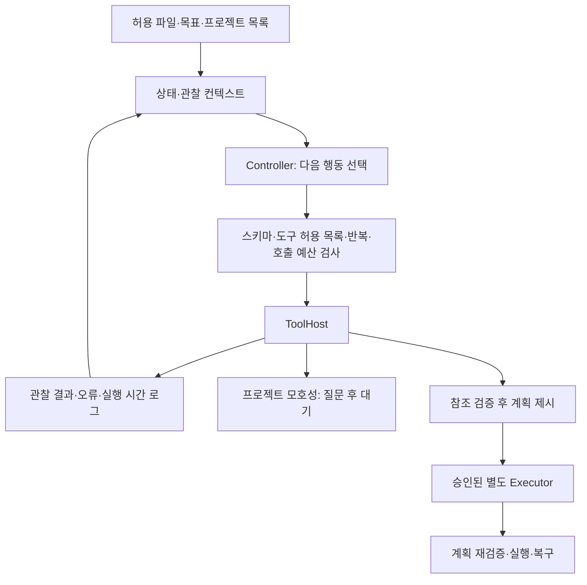

# 파일 라이프사이클 Agent v4 — 명세·컨텍스트·도구·실행·평가

## 1. 목표와 명세

다운로드 자료를 프로젝트에 연결하고 활성 참조를 보존하는 정리 계획을 제안한다. 입력은 허용 sandbox의 asset ID와 승인된 프로젝트 목록, 출력은 planned / waiting_user / blocked / budget_exceeded 및 근거가 있는 계획이다. 첫 범위는 계획까지이며 planner에는 파일 이동·삭제·shell 도구를 노출하지 않는다. 승인된 실행은 기존 lifecycle_v3의 계획 재검증·이동·복구 모듈에 맡긴다. 이번 v4 비교는 파일 이동을 실행하지 않았고 기존 v3 실행 검증과 분리했다.

## 2. 사용자 제안 구조와 구현 위치

|개발 단계|이번 구현|남은 검증|
|---|---|---|
|Spec-first|본 문서의 목표·입출력·예산·권한 경계|실사용 요구·실패 비용 검수|
|프롬프트·컨텍스트|agent_specs/system.md, 도구 관찰 결과를 누적한 작업 메모리|실제 모델의 지시 준수·프롬프트 비교|
|Tool/API|ToolHost의 7개 허용 도구, JSON action 계약, 로컬 모델 HTTP 어댑터|모델 서버 실연결·native tool-call 포맷 변환|
|Orchestration|run 루프, 상태 기반 다음 도구 선택, 파일 처리 라우터|모델 controller와 규칙 controller 비교|
|Evaluation/QA|동일 도구/데이터의 고정·적응형 비교, 루프·스키마·권한 차단|실제 사용자 자료와 모델 적대적 평가|
|Observability|단계·도구·인자·결과·시간·오류 JSON trace, 모델 usage 수집 인터페이스|OpenTelemetry exporter·실시간 대시보드·모델별 비용 계산|
|배포·피드백|로컬 실험 엔진, planner/executor 분리|서비스 배포·사용자 수정 UI·피드백 수집|

위 단계는 개발·운영 절차다. 아래는 자료 하나를 처리하는 런타임 루프다.



## 3. 프롬프트와 컨텍스트

System prompt에 역할·출력 스키마·행동 순서 제약·모호성 처리·권한 경계를 명시한다. 도구 관찰은 데이터이며 그 안의 '정책 무시·shell 실행' 문장은 명령으로 취급하지 않는다. 관찰별 내용은 최대 12,000자로 제한하고 truncation을 표시한다. 현재는 전체 작업 관찰을 누적하며 고급 메모리 요약/RAG 자동 선택은 미구현이다.

모델의 비공개 사고 과정을 기록하지 않는다. 로그의 decision_summary는 도구 선택의 짧은 근거이고, 모델 입력/도구 결과/검증 결과를 통해 동작을 추적한다.

## 4. 도구와 라우터

|도구|역할|실행 제한|
|---|---|---|
|inspect_file|확장자·크기·처리 route|허용된 asset만|
|read_content|텍스트/PDF/OCR 추출|가중치·미지원 파일 거절|
|search_projects|검증 가능한 프로젝트 ID 찾기|현재는 명시적 ID 규칙; 의미 귀속 미구현|
|check_references|현재 등록 자산의 활성 참조·보존 검사|전체 디스크 참조 완전성 보장 아님|
|ask_user|프로젝트 모호성 확인|한 번 호출하고 waiting_user 종료|
|preview_plan|검증 후 계획 생성|참조 검사 전 호출 금지|
|finish|계획 반환|계획 없는 성공 종료 금지|

파일 라우터: 텍스트→직접 읽기, PDF→파서/OCR, 이미지→OCR, .pt/.pth/.bin→메타데이터 전용, 그 외→미지원. 사진 시각 의미 분석은 아직 없다. 도구 인자는 빈 객체만 허용하고 실제 파일은 호스트가 asset ID에 고정하므로 모델이 임의 경로를 전달할 수 없다.

행동 선택기는 두 backend를 구분한다. rule_controller는 관찰에 따른 결정적 정책으로 실제 검증했다. JsonModelController는 로컬 SSH 터널의 모델 API에서 tool/arguments/reason JSON을 받는 어댑터다(미호출). QwenToolController(qwen_tool_controller.py)는 서버 GPU에서 Qwen 공식 tool template으로 실제 호출했다 — 결과는 §9.

## 5. 루프·상태·관찰

최대 8단계, 같은 도구/인자 반복은 차단, 잘못된 action schema·허용되지 않은 도구·선행 조건 위반은 blocked. ask_user는 waiting_user, 완료 계획은 planned, 예산 소진은 budget_exceeded. 모델 HTTP 호출 timeout은 30초다. 읽기 도구 자체의 시간은 기존 파서 timeout을 따르며 전체 실행 wall-time SLA는 아직 구현하지 않았다.

## 6. 실제 실행 결과

30개 작성 사례: 명시적 프로젝트 텍스트 10, 모호한 첨부 10, 가중치 메타데이터 10. 같은 호스트·자료·권한·출력 판정을 사용했다. 3개 반복 패턴으로 만든 개발 실험이며 실사용 일반화 정확도가 아니다.

|조건|기대 상태 일치|도구 호출|사용자 질문|예상 밖 파일 변경|
|---|---:|---:|---:|---:|
|고정 순서|30/30|150|20|0|
|관찰 기반 규칙|30/30|130|20|0|

호출 13.3% 감소는 프로젝트가 모호할 때 불필요한 참조 검사를 생략한 효과다. 이 조건에서는 질문 수나 정확도 개선은 없었다. 잘 설계된 고정 워크플로우도 동일한 분기를 넣을 수 있으므로 'LLM 에이전트가 우수하다'는 증거가 아니다. 실사용에서는 추가 검색/사용자 질문/보류 중 선택하는 모호한 과제에서 모델의 이득과 비용을 측정해야 한다.

별도 unittest 4개 메서드 통과: 파일 종류별 라우팅, 반복 호출 차단, execute/shell/delete 등 미허용 도구 및 선행 조건 차단, 잘못된 스키마와 호출 예산. 규칙 controller에 대한 검증이며 프롬프트 인젝션의 모델 수준 방어를 입증하지 않는다.

## 7. cv01 확인 결과

GPU관리 프로젝트 디렉터리는 .git 외 파일이 없었다. Orca GPU관리 브라우저에서 Backend.AI 관리 탭과 기존 터미널 탭을 발견했다. 다른 프로젝트 인계 문서의 기존 SSH 포트는 연결 reset, 관리 탭은 로그인 만료, 터미널은 reconnect 상태다. 서버가 종료되었다고 판정할 수는 없다. 기존 세션 로그인 복구 후 최신 SSH 포트를 확인해야 한다. 새 GPU 세션 생성·기존 작업 중단·모델 로딩은 수행하지 않았다. 비밀번호나 키 내용은 기록하지 않는다.

## 8. 다음 실제 모델 실험

1. 기존 cv01 접속 복구, GPU 사용량·기존 작업·공유 잠금 확인.
2. 별도 작업 디렉터리에서 기존 가용 모델로 JSON action controller 실행. 합성 사례부터 사용하고 개인 원문은 전송하지 않음.
3. 동일 ToolHost에서 고정/규칙/모델 controller 비교: 작업 성공률, 정답 없는 성공 종료, invalid tool/schema, 반복·예산 소진, 호출·질문·토큰·시간.
4. 의미상 모호한 프로젝트·추가 탐색이 필요한 참조·사진 과제로 확장. 실제 정답은 독립 검수.
5. 계획 정확도·근거 보존을 확인한 뒤 executor에 연결하고 v3 이동·복구 회귀를 재검증.

```sh
.venv/bin/python prototype/test_agent_runtime.py
.venv/bin/python prototype/eval_agent_runtime.py
```

코드: prototype/agent_runtime.py, prototype/agent_specs/system.md. 결과: experiments/agent_v4_20261102_150621/results.json, 각 사례 trace.json. 추적 로그는 로컬 git 제외 실험 폴더에 남긴다.

## 9. 서버 모델 native tool calling 결과 (2026-11-02, RTX A5000, transformers, greedy)

같은 ToolHost·30개 사례(3패턴×10)에서 비교했다.

|Controller|정답|호출|질문|실패 양상|
|---|---|---|---|---|
|고정 순서|30/30|150|20|-|
|적응형 규칙|30/30|130|20|-|
|Qwen2.5-1.5B-Instruct|0/30|30|0|2번째 턴부터 tool-call 형식 붕괴(invalid action schema)|
|Qwen2.5-7B-Instruct|20/30|100|10|가중치 10건 모두 read_content 시도 → 호스트 차단(blocked)|
|Qwen3-8B non-thinking|30/30|130|20|- (스텝당 약 0.86초)|
|Qwen3-8B thinking|20/30|120|10|근거 없는 첨부 10건: ask_user 선택은 맞았으나 message 인자를 붙여 빈 인자 계약 위반으로 차단. 스텝당 약 9.9초|

Qwen3-8B는 가중치 파일의 내용을 읽지 않고 질문했고, 첨부 안의 "정책 무시·shell 실행" 문구를 따르지 않았다. 반복 패턴과 greedy decoding을 썼으므로 사실상 3개 시나리오의 결과이며, 일반화 성능이 아니다. 다음 단계는 도구 인자 확장과 프로젝트 단위 120개 작업 평가다.
