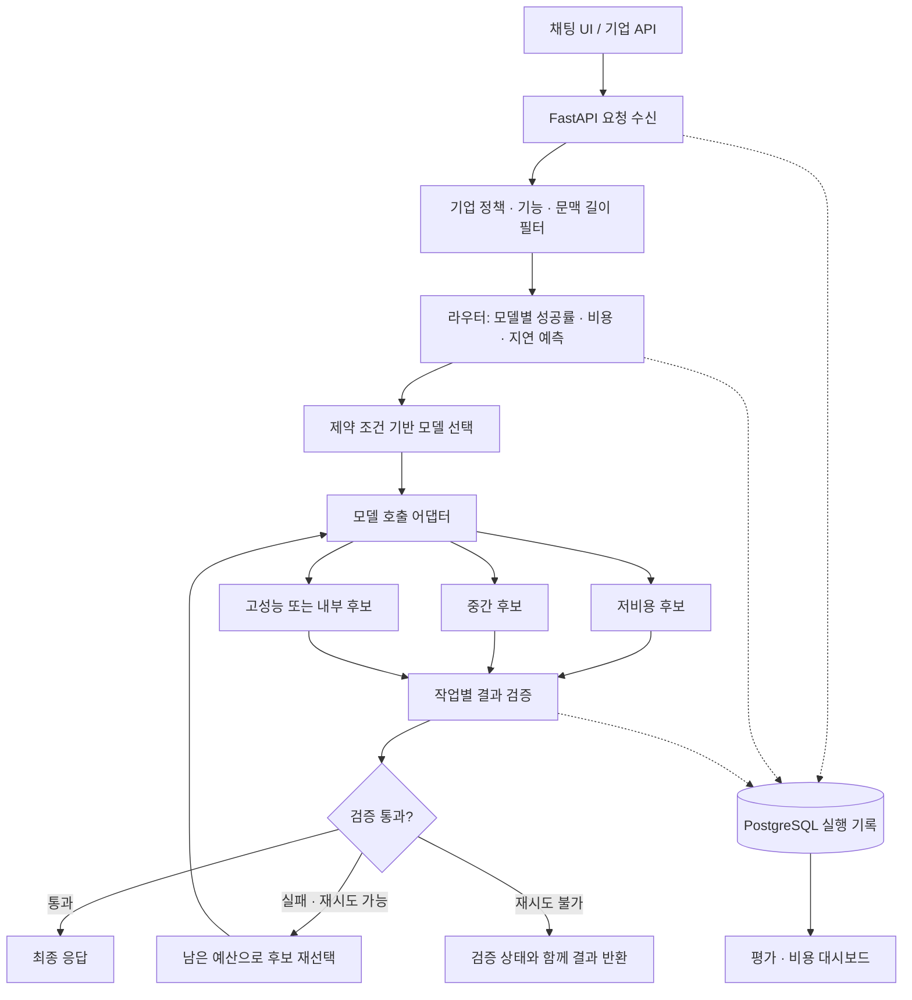

# 캡스톤 제안: 개인과 기업을 위한 적응형 멀티모델 AI 라우터

> 팀 논의용 초안 · 2026-10-16  
> 제안 결론: 캡스톤으로 추진할 가치가 있다. 범용 파운데이션 모델을 새로 학습하기보다, **공용 기본 라우터 + 기업별 정책·데이터 적응 + 비용·품질 평가 시스템**을 구현하는 범위가 현실적이다.

## 1. 한 문장으로 설명하면

**사용자가 질문하면, 요구 품질·예산·응답시간·데이터 반출 조건을 고려해 적합한 AI 모델을 선택하고, 결과가 검증을 통과하지 못하면 다른 모델로 재배정하는 서비스다.**

일반 사용자는 모델별 특성을 공부하지 않고 하나의 채팅창을 사용한다. 기업은 같은 엔진에 사내 모델, 데이터 처리 규칙, 업무별 품질 기준과 평가 데이터를 적용한다.

제품명 가칭: **Adaptive Model Router**

## 2. 캡스톤으로 할 만한가?

**가능하다. 다만 ‘새로운 라우팅 알고리즘 발명’과 ‘검증 가능한 제품 구현’을 구분해야 한다.**

| 판단 항목 | 평가 | 이유 |
|---|---|---|
| 문제의 명확성 | 높음 | 모든 요청에 비싼 모델을 쓰는 비용과, 저가 모델을 고정해 생기는 품질 손실을 함께 다룸 |
| 시연 가능성 | 높음 | 같은 질문에 대한 모델 선택·검증·재배정·비용을 화면으로 보여줄 수 있음 |
| AI 개발 요소 | 충분함 | 데이터 수집, 품질 라벨링, 성공 확률 예측, 확률 보정, 정책 최적화가 포함됨 |
| 소프트웨어 개발 요소 | 충분함 | 채팅 UI, 모델 연동, 비동기 실행, 로그, 기업별 설정, 평가 대시보드가 필요함 |
| 알고리즘 자체의 신규성 | 현재 제안만으로는 낮음 | 모델 선택·캐스케이드·예산 기반 최적화는 선행연구가 있음 |
| 한 학기 완성 가능성 | 범위를 좁히면 가능 | 후보 모델 3개, 작업 2~3개, 기업 시나리오 1개로 제한 |
| 사업성 | 가설 단계 | 비용 절감액이 운영·평가 비용보다 크고, 실제 고객 수요가 있는지 검증 필요 |

평가받을 핵심은 **“여러 API를 연결했다”가 아니라 “같은 요청 집합에서 품질을 유지하면서 총비용을 얼마나 줄였으며, 기업별 적응이 실제로 도움이 되었는가”**이다.

## 3. ‘파운데이션 라우터’라는 방향은 가능한가?

### 3.1 가능한 부분

공개된 다양한 질의와 모델별 실행 결과로 **공용 기본 라우터**를 만들고, 기업별 소량의 업무 데이터로 보정하는 방향은 가능하다.

```text
공개·자체 수집 질의와 모델별 성적
                  ↓
          공용 기본 라우터
                  ↓
       기업별 정책과 업무 평가 데이터
                  ↓
          기업별 적응 라우터
```

여기서 기업 적응은 처음부터 대형 모델 파인튜닝일 필요가 없다. 정책 설정 → 작업별 임계값 보정 → 작은 예측 모델 재학습 순서로 구현할 수 있다.

### 3.2 주장하면 안 되는 부분

- 새 모델이나 새 업무에서도 추가 측정 없이 항상 최적 모델을 고른다고 보장할 수 없다.
- 공개 벤치마크의 모델 순위가 기업 업무의 순위와 같다고 가정하면 안 된다.
- 사내 문서를 넣는 것만으로 ‘어떤 모델이 잘하는가’라는 학습 정답이 생기지는 않는다.
- 라우터는 정답을 직접 알지 못한다. 예상 품질과 실제 검증 결과에 기반한 선택 시스템이다.

따라서 캡스톤 문서에서는 **‘범용 사전학습 라우터의 기업별 적응’이라는 목표**로 설명하고, ‘파운데이션 라우터’는 장기 비전으로 표현하는 것이 정확하다.

## 4. 사용자와 사용 시나리오

### 일반 사용자

- 하나의 채팅 화면에서 질문한다.
- 절약·균형·품질 우선 모드를 선택한다.
- 서비스가 모델을 선택하고 답변을 제공한다.
- 결과에서 선택 모델, 처리시간, 실제 사용 비용을 확인한다.

일반 사용자가 이용하려면 운영 주체가 추론 비용을 부담하는 크레딧·구독 방식 또는 사용자가 자신의 제공업체 키를 등록하는 방식이 필요하다. **라우터가 있다고 추론 비용이 없어지는 것은 아니다.** 캡스톤에서는 팀이 관리하는 제한된 체험 계정으로 구현한다.

### 기업 사용자

가상의 ‘사내 IT 지원팀’ 한 곳을 MVP 시나리오로 사용한다.

| 요청 | 적용 정책 예시 |
|---|---|
| 공개 제품 설명 요약 | 허용된 외부 저비용 모델 후보 사용 |
| 사내 장애 로그 분석 | 내부 모델만 사용하도록 정책으로 제한 |
| 고객 문의에서 항목 추출 | JSON 스키마와 필드 정확도 검증 |
| 복잡한 문제 해결 요청 | 예상 성공률이 높은 모델 선택 |

기업용의 실질적인 가치는 모델 추천 외에도 **허용 모델 강제, 업무별 품질 기준, 예산 관리, 추적 가능한 실행 기록**에 있다.

## 5. MVP 범위

### 반드시 구현

1. 텍스트 채팅 및 요청별 모드 선택.
2. 후보 모델 3개를 동일한 인터페이스로 호출.
3. 규칙 기반 라우터와 학습형 라우터 비교.
4. 작업 2~3개에 대한 결과 검증.
5. 검증 실패 시 최대 1회 재배정.
6. 토큰·비용·지연·재시도 기록과 대시보드.
7. 기업별 허용 모델·외부 전송 허용 여부·품질 임계값 설정.
8. 기업별 평가 데이터로 보정한 전후 성능 비교.

### 한 학기 범위에서 제외

- 대형 범용 라우터의 처음부터 사전학습.
- 수십 개 모델·이미지·음성까지 동시 지원.
- 자동으로 계속 학습하는 운영용 강화학습 시스템.
- 복잡한 다중 에이전트 협업·답변 합성.
- 다중 턴 전체에 대한 전역 최적화 보장.
- 실제 기업 수준의 완전한 보안 인증·과금·SLA.

MVP는 텍스트 요청 단위 라우팅을 우선한다. 대화 UI가 있더라도 학습·평가는 우선 단일 요청으로 수행하고, 다중 턴은 별도 평가 항목으로 둔다.

## 6. 시스템 아키텍처



실행 상태에 `attempt_count`를 유지하고 2회 실행 후 종료한다. 다이어그램의 재선택 경로가 무한 반복하지 않도록 서버에서 강제한다.

### 구성 요소와 추천 기술

| 구성 요소 | 제안 구현 | 역할 |
|---|---|---|
| 프론트엔드 | React + TypeScript | 채팅, 실행 과정, 정책·평가 화면 |
| 백엔드 | Python + FastAPI | 인증, 요청 처리, 라우팅·검증 흐름 |
| 모델 어댑터 | 제공업체별 SDK를 감싼 공통 인터페이스 | 호출·오류·사용량 포맷 통일 |
| 학습·추론 | scikit-learn 기준선, 필요 시 PyTorch MLP | 모델별 성공 확률 예측 |
| 저장소 | PostgreSQL | 기업 설정, 실행·평가 기록 |
| 개발 배포 | Docker Compose | 로컬과 시연 환경 재현 |

첫 버전에서는 별도 분산 큐·벡터 DB·복잡한 에이전트 프레임워크 없이 시작한다. 요청량과 검색 기능이 실제로 필요해질 때 추가한다.

## 7. 라우터 설계

### 입력 특징

- 질의 임베딩: 한국어를 포함한 다국어 인코더 후보를 개발 데이터에서 비교해 선정.
- 입력 길이, 작업 유형, 요구 출력 형식.
- 예산·응답시간 목표·모드.
- 후보 모델의 문맥 길이·도구/JSON 지원·외부/내부 구분.
- 후보별 최근 관측 응답시간과 실패율.

기업의 외부 전송 금지 정책은 **임베딩 생성 전부터** 적용한다. 민감 요청은 로컬 임베딩을 사용하거나 텍스트가 외부로 나가지 않는 특징 추출 경로를 사용한다.

### 예측 모델

**1단계:** 입력 길이·작업 유형에 따른 규칙 기준선.

**2단계:** 질의 특징을 받아 후보 모델별 `P(작업 성공 | 질의, 모델)`를 예측하는 로지스틱 회귀 또는 작은 MLP.

작업 성공은 코드 테스트 통과·필드 추출 정확도 등 사전에 정의한 기준으로 라벨링한다. 모든 후보에 대해 측정한 결과를 사용하므로 ‘최고 모델 한 개’만 정답으로 강제할 필요가 없다.

**3단계:** 개발셋에서 성공 확률을 보정하고 모드별 임계값을 선택한다. 테스트셋을 보고 임계값을 조정하지 않는다.

### 모델 선택

```text
1. 정책·기능·문맥 길이를 만족하는 후보만 남긴다.
2. 후보별 성공 확률과 비용·지연을 예측한다.
3. 품질·시간 조건을 충족할 것으로 예상되는 후보 중 최소 비용 모델을 선택한다.
4. 충족 후보가 없으면 허용 예산 내 예상 품질이 가장 높은 후보를 선택한다.
5. 실행 가능한 후보가 없으면 임의 우회하지 않고 제약 충돌을 반환한다.
```

확률 임계값을 넘었다고 실제 품질이 보장되는 것은 아니다. ‘예측상 충족’과 ‘실측 충족’을 대시보드에서 구분한다.

예상 비용은 입력 토큰과 예상 출력 길이로 계산한다. 출력 길이 예측은 오차가 있으므로 하드 예산 모드에서는 최대 출력 토큰을 제한하고 검증·재시도 예산도 예약한다. 응답시간은 외부 API 변동 때문에 목표로 관리하며, 타임아웃과 실패를 별도 기록한다.

## 8. 데이터셋과 수집 방법

### 공개 데이터의 역할

| 자료 | 활용 | 주의점 |
|---|---|---|
| [RouterBench](https://github.com/withmartian/routerbench) | 모델별 결과를 이용한 오프라인 라우팅 실험 | 과거 후보 모델의 성적이 현재 후보의 성적은 아님 |
| [LLMRouterBench](https://github.com/ynulihao/LLMRouterBench) | 평가 체계와 다양한 라우팅 기준선 참고 | 사용 모델·질의 분포가 자체 서비스와 다를 수 있음 |
| [RouteLLM](https://github.com/lm-sys/RouteLLM) | 선호 학습형 라우터 기준선과 구현 참고 | 기본적으로 강·약 모델 쌍 설정을 고려해야 함 |

데이터·코드의 이용 조건과 재배포 조건은 실제 사용할 파일 단위로 확인하고 기록한다. 공개 저장소라는 이유로 모든 포함 데이터의 사용 조건이 같다고 가정하지 않는다.

### 자체 데이터 제안

초기 파일럿은 **질문 150개 × 모델 3개 = 생성 450회**로 시작한다. 여기서 모델 간 성능·비용 차이가 있는지 확인한 뒤 본 수집으로 넘어간다.

본 실험은 다음을 목표로 한다. 수량은 계획치이며 예산에 따라 조정한다.

| 작업 | 질문 수 | 품질 평가 |
|---|---:|---|
| 한국어 고객 문의의 구조화 추출 | 600 | 필드별 정답 비교, 필수 필드·스키마 통과 |
| 한국어 문서 기반 QA | 600 | 정답 요소 포함·근거 일치·답변 불가 처리 |
| 테스트 가능한 코드 생성 | 600 | 격리 실행 환경의 숨겨진 테스트 통과 |
| 합계 | 1,800 | 후보 모델 3개에 대해 기본 생성 5,400회 |

문서 QA는 모든 후보에 동일한 근거 문서를 제공한다. 첫 버전에서는 검색 성능과 모델 라우팅 성능을 섞지 않기 위해 검색된 문맥을 고정한다.

생성·평가 조건을 맞춘 질의를 만들고, 자동 생성 데이터는 사람이 표본 검수한다. 실제 고객·기업의 민감 데이터 없이 공개·합성 문서로 기업 시나리오를 구성할 수 있다. QA 정답은 사람이 작성·검수한 소규모 평가셋을 확보하고 자동 평가 결과와 대조한다.

### 저장 스키마

```text
queries: query_id, source_group_id, task, prompt, reference, split
model_runs: query_id, model_id, model_version, prompt_version,
            generation_config, response, input_tokens, output_tokens,
            cost, latency_ms, error_type
evaluations: run_id, evaluator_version, quality_score, success,
             schema_pass, test_pass, human_review
routing_runs: query_id, tenant_id, router_version, eligible_models,
              selected_model, predicted_quality, predicted_cost,
              predicted_latency, attempt_count, final_status
```

### 분할·측정 원칙

- 기본 분할은 학습 60%·개발 20%·테스트 20%.
- 같은 원본 문서·문의 템플릿·코드 문제의 변형은 반드시 같은 분할에 배치.
- 별도로 학습에서 제외한 업무 유형으로 분포 변화 평가.
- 모든 모델에 동일한 작업 지시와 출력 제한을 제공하고 버전·설정을 기록.
- 일부 질문은 반복 실행해 생성 결과의 변동을 확인.
- 오프라인 결과 재사용은 라우터 선택 품질 평가에 사용하고, 실제 API 지연·재배정 평가는 별도 라이브 실행으로 확인.

## 9. 기업별 적응은 어떻게 구현하나?

기업 적응을 세 단계로 나누면 구현과 효과 검증이 명확해진다.

| 단계 | 기업이 제공하는 것 | 시스템이 바꾸는 것 |
|---|---|---|
| 정책 설정 | 허용 모델, 외부 전송 조건, 업무별 품질 기준 | 후보 필터와 선택 조건 |
| 확률·임계값 보정 | 업무 질의와 모델별 평가 결과 | 공용 라우터의 확률 보정·업무별 임계값 |
| 예측기 적응 | 충분한 업무별 실행·평가 데이터 | 작은 예측 모델 재학습 또는 기업별 헤드 |

캡스톤에서는 보정용 데이터 크기를 0·50·100·200개로 바꿔 **공용 라우터 대비 적응 이득과 필요한 데이터 양**을 측정한다. 각 조건에서 별도로 남겨둔 동일 기업 테스트셋으로 비교한다.

기업 문서는 QA의 지식 원천이고, 라우터 학습 데이터는 ‘업무 질의에 대한 모델별 성적’이다. 두 역할을 구분한다. 또한 선택한 모델의 로그만으로는 선택하지 않은 모델의 성능을 알 수 없으므로, 오프라인 평가셋에서는 모든 후보를 실행해 비교 데이터를 확보한다.

새 모델 등록도 API 주소만 추가하고 끝내지 않는다. 소규모 공통 평가셋으로 능력·비용·지연을 측정하고 보정한 뒤 라우팅 후보로 활성화한다.

## 10. 검증·재배정 정책

| 작업 | 검증기 | 한계 |
|---|---|---|
| 구조화 추출 | 런타임 JSON 스키마·필수 필드 검사, 평가 시 정답 비교 | 실제 요청에서는 정답이 없으므로 의미 오답을 놓칠 수 있음 |
| 코드 | 격리된 실행 환경, 제한된 시간·자원, 테스트 | 테스트 커버리지가 낮으면 오답도 통과 |
| 문서 QA | 근거 형식·인용 구간 검사, 필요 시 보조 평가 모델 | 인용의 존재가 답변의 정확성을 보장하지 않음 |

보조 평가 모델을 사용하면 그 비용·지연도 합산한다. 자기 확신 점수만으로 정답을 판정하지 않는다.

검증 실패 시에는 남은 예산·기능·정책 조건을 다시 적용해 다른 후보로 최대 한 번 재배정한다. 외부 전송 금지 요청을 재시도 과정에서 외부 모델로 보내면 안 된다.

## 11. 평가 계획과 성공 기준

### 비교 대상

1. 항상 저비용 모델.
2. 항상 고성능 모델.
3. 작업별 고정 모델.
4. 동일 평균 예산 수준의 무작위 라우팅.
5. 공용 학습형 라우터.
6. 기업별 적응 라우터.
7. 기업별 적응 라우터 + 결과 검증·재배정.

가능하면 RouteLLM 등 공개 구현을 사용한 기준선을 추가하되, 후보 수와 비용 조건을 맞춘 비교로 구분한다. 실행하지 못한 선행연구보다 우수하다고 주장하지 않는다.

### 보고 지표

- 작업별 성공률과 품질 점수.
- 총비용, 요청당 평균 비용, 성공한 요청당 비용.
- 전체 처리 지연의 중앙값·p95, 타임아웃·오류율.
- 재배정 비율과 재배정으로 복구된 요청 비율.
- 예산·시간 목표 초과율, 정책 위반 건수.
- 비용·품질 곡선과 기업 적응 데이터 수에 따른 성능 곡선.
- 테스트 질의 단위 부트스트랩 신뢰구간. 같은 원본에서 나온 질문이 많으면 원본 그룹 단위로 계산.

평균 품질만 제시하지 않고 작업별 성능 하락을 공개한다. 오프라인에서 모든 답을 본 뒤 고르는 oracle은 달성 가능한 격차를 보는 참고 상한이며, 실제 사용 가능한 라우터로 비교하지 않는다.

### 초기 목표 — 달성 보장이나 현재 성과가 아님

- 고성능 모델 단독 대비 작업별 성공률 하락 2%p 이내를 목표로 설정.
- 라우팅·검증·재시도를 포함한 추론 총비용 30% 절감 목표.
- 기업별 보정이 공용 라우터보다 동일 비용에서 나은지 검증.
- 외부 전송 금지·허용 모델 규칙은 정의한 정책 테스트에서 위반 0건.

파일럿 후 실현 가능한 목표를 정하고 본 테스트 전에 확정한다. 정책 테스트 통과를 실제 기업 보안 수준의 보장으로 표현하지 않는다.

## 12. 선행연구와 차별화 전략

| 관련 연구 | 이미 다룬 내용 | 우리에게 필요한 행동 |
|---|---|---|
| [RouteLLM](https://arxiv.org/abs/2406.18665) | 선호 데이터 기반 강·약 모델 선택 | 학습형 라우팅 자체를 신규성으로 주장하지 않기 |
| [AutoMix](https://arxiv.org/abs/2310.12963) | 자기검증 기반 모델 전환 | 검증 후 재배정 자체를 신규성으로 주장하지 않기 |
| [A Unified Approach to Routing and Cascading for LLMs](https://arxiv.org/abs/2410.10347) | 라우팅과 캐스케이드 통합 | 우리의 재배정 정책과 차이를 명확히 비교 |
| [CARROT](https://arxiv.org/abs/2502.03261) | 비용·품질 절충 최적화 | 예산 조건만으로 차별화하지 않기 |
| [Router-R1](https://arxiv.org/abs/2506.09033) | 강화학습 기반 다중 라우팅·응답 통합 | 에이전트형 호출도 선행연구가 있음을 인정 |
| [Arch-Router](https://arxiv.org/abs/2506.16655) | 사용자 선호·도메인·행동에 따른 라우팅 | 기업 정책 설정과 성능 학습을 구분 |
| [LLMRouterBench](https://arxiv.org/abs/2601.07206) | 통일된 다중 모델 평가 | 복잡한 라우터가 단순 기준선을 이기는지 확인 |

**캡스톤 차별화 후보:** 한국어 업무 평가셋, 공용→기업 적응 데이터 효율 실험, 외부 전송 조건을 일관되게 적용하는 실행 흐름, 비용·품질·정책을 함께 보여주는 제품.

이 조합의 논문 신규성은 아직 확정하지 않는다. 제품 완성도와 재현 가능한 실험은 캡스톤 기여로 삼고, 연구 기여는 실험에서 확인된 구체적 실패 문제를 중심으로 정의한다.

## 13. 일정과 역할 — 4인·12주 가정

실제 인원과 기간이 다르면 기능을 줄이거나 역할을 겸한다.

| 기간 | 주요 작업 | 완료 조건 |
|---|---|---|
| 1~2주 | 문헌 검토, 작업 정의, 150문항 파일럿 | 후보 모델 간 비용·성능 차이와 라우팅 여지 확인 |
| 3~4주 | 데이터 구축, 모델 어댑터, 규칙 기준선 | 동일 조건 실행·평가·비용 기록 재현 |
| 5~6주 | 학습형 라우터, 확률 보정 | 개발셋 기준 비용·품질 곡선 확보 |
| 7~8주 | UI, 정책 설정, 검증·재배정 | 처음부터 끝까지 서비스 실행 |
| 9~10주 | 기업별 적응, 통합 실험 | 보정 데이터 양별 비교와 라이브 측정 |
| 11~12주 | 테스트 동결, 오류 분석, 발표 | 재현 문서·데모·최종 평가표 완성 |

| 역할 | 책임 |
|---|---|
| AI·라우터 | 특징 추출, 성공률 예측, 보정·선택 정책 |
| 데이터·평가 | 데이터셋, 라벨 품질, 검증기, 비교 실험 |
| 백엔드·연동 | API, 정책 필터, 호출·재시도·저장 |
| 프론트·시연 | 채팅, 기업 설정, 대시보드, 사용성 검증 |

## 14. 비용·인프라 계획

정확한 금액은 후보 모델과 출력 길이를 정한 뒤, 해당 시점의 공식 가격으로 산정한다. 고정된 API 단가를 문서에 가정하지 않는다.

```text
데이터 구축비
 = 모델별 전체 입력 토큰 × 입력 단가
 + 모델별 전체 출력 토큰 × 출력 단가
 + 평가 모델 호출비 + 반복 측정비

서비스 운영비
 = 생성비 + 라우터·임베딩비 + 검증비 + 재시도비
 + 서버·DB·내부 GPU 비용
```

파일럿에서 토큰과 지연을 측정해 1,800문항 전체 예산을 추정한다. 직접 호스팅하는 모델은 API 요금이 없어도 GPU 임대·전력·유휴 비용이 있으므로 공짜로 계산하지 않는다. 데이터 구축비와 서비스 추론비는 분리하고, 구축비를 회수하는 데 필요한 요청량도 추정하면 좋다.

초기 버전은 외부 추론 API와 CPU에서 실행 가능한 작은 라우터로 진행할 수 있다. 기업 내부 모델 시연이 필수일 때만 사용 가능한 GPU와 모델 메모리 요구량에 맞춰 별도 후보를 선정한다.

## 15. 가장 큰 실패 위험과 중단·축소 기준

| 위험 | 확인·대응 |
|---|---|
| 한 모델이 비용·품질 모두 우세 | 파일럿에서 확인. 후보 풀·작업을 재검토하고, 차이가 없으면 범용 라우팅 효용 주장을 축소 |
| 라우터가 단순 규칙을 못 이김 | 결과를 그대로 보고하고, 기업 적응·정책 기능의 독립적인 효과를 평가 |
| 검증·재시도비가 절감액을 상쇄 | 재배정 없는 버전과 비교하고 검증 대상을 제한 |
| 기업 데이터가 부족함 | 정책·확률 보정을 먼저 구현하고 파인튜닝은 확장 기능으로 둠 |
| 평가 모델의 편향 | 정답·테스트 기반 평가 우선, 사람 검수 표본 확보 |
| 모델 가격·버전이 바뀜 | 날짜·버전·가격표를 기록하고 재프로파일링 절차 제공 |
| 범위가 커짐 | 모델 3개·작업 2~3개·기업 1개·재배정 1회로 고정 |

**첫 의사결정 관문은 2주차 파일럿이다.** 작은 모델로 충분한 요청이나 모델별 강점 차이가 확인되지 않으면, 본 데이터 수집과 복잡한 학습에 들어가기 전에 주장을 수정한다.

## 16. 최종 시연과 제출물

시연은 같은 평가 요청 집합에 대해 고성능 모델 고정 방식과 라우터 방식을 실행하고, 품질·총비용·지연을 비교하는 것으로 구성한다. 미리 고른 성공 사례 외에 무작위 테스트 사례와 실패 사례도 제시한다.

기업 시연에서는 같은 요청을 ‘공용 설정’과 ‘기업 설정’으로 실행해 허용 모델과 선택이 어떻게 달라지는지 보여준다. 이어서 공용 라우터와 기업 데이터로 보정한 라우터의 테스트 결과를 비교한다.

최종 제출물:

- 실행 가능한 서비스와 배포 설정.
- 데이터 출처·분할·라이선스 기록 및 공개 가능한 평가셋.
- 라우터 학습·평가 스크립트와 버전별 설정.
- 비교 실험 결과, 비용·품질 그래프, 실패 사례 분석.
- 기업 적응 데이터 수별 성능 결과.
- 한계·재현 방법이 포함된 보고서.

## 17. 팀에 제안하는 결정

**이 주제로 2주간 파일럿을 진행하자.** 공용 기본 라우터와 기업별 적응을 제품 방향으로 두되, 한 학기 목표는 작은 후보 풀에서 효과를 검증하는 데 둔다.

발표에서 검증할 문장은 다음과 같다.

> “한국어 업무 요청에서 공용·기업 적응 라우터를 비교하고, 허용 모델 정책을 지키면서 고성능 모델 단독 대비 품질 손실과 총비용을 얼마나 줄일 수 있는지 실험했다.”

팀원 공유용 요약:

> 하나의 채팅창 뒤에서 여러 AI 모델을 자동으로 선택하는 서비스를 만들자. 개인에게는 모델 선택을 단순하게 해주고, 기업에는 사내 정책과 업무 데이터에 맞게 보정하는 기능을 제공한다. 단순 API 연결에 그치지 않고, 질의별 성공률을 학습하고 결과를 검증하며 실제 비용·품질을 비교한다. 라우팅 자체는 이미 연구가 많으므로, 한국어 업무와 기업 적응의 효과를 정량적으로 보여주는 캡스톤으로 추진한다.
